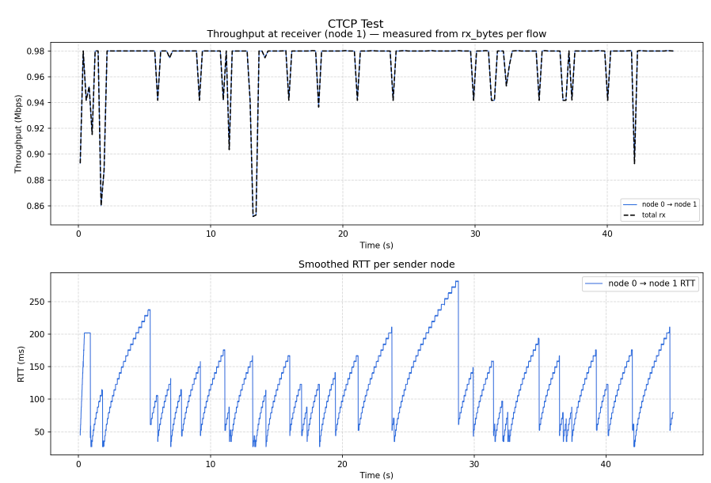
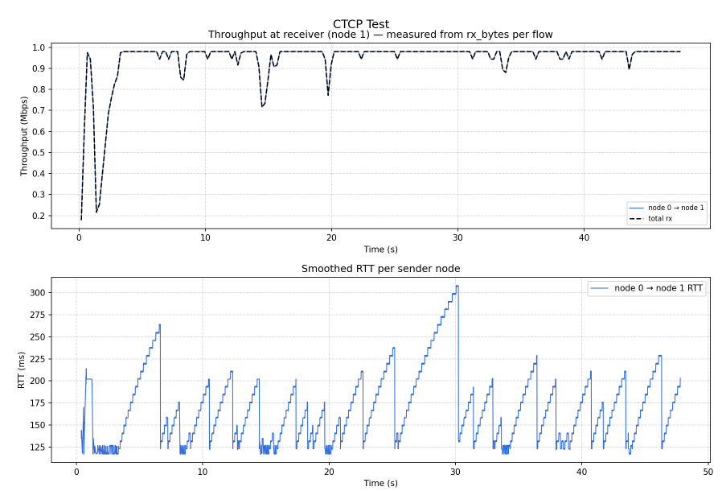
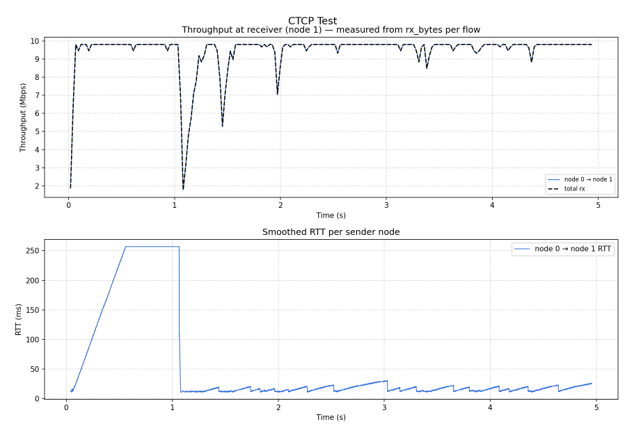
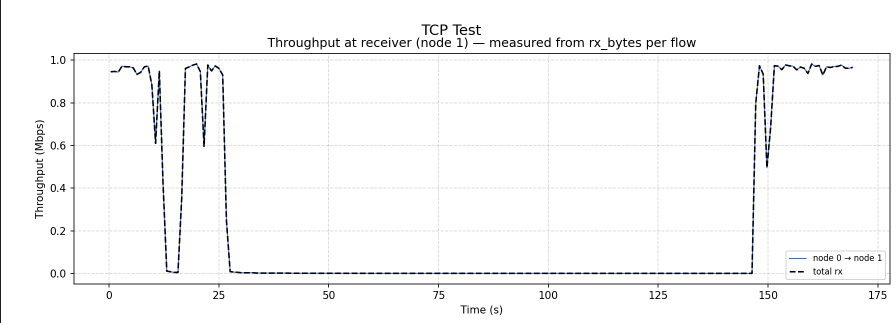
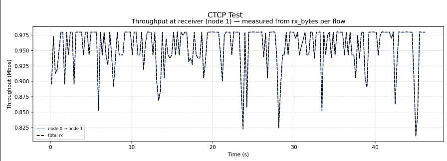
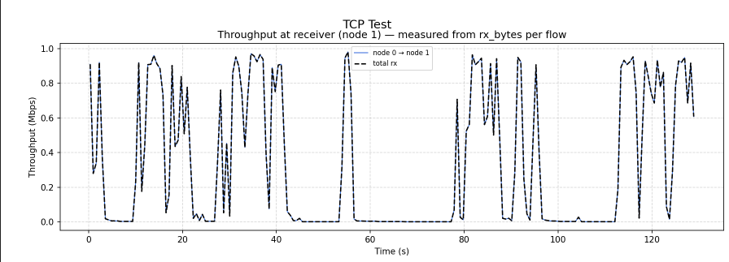
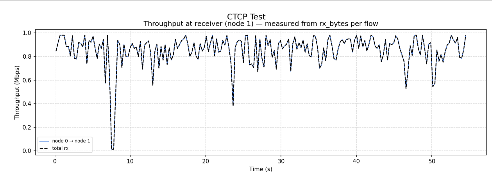

# Coded TCP (CTCP) — Network Protocol Implementation and Evaluation

A C++ implementation of **Coded TCP (CTCP)** in the ns-3 network
simulator, with an experimental evaluation of network coding overhead
and throughput under packet loss.

Developed as a final project for **CS856: Transport Layer Protocols**
at the University of Waterloo.

**[Read the Technical Report](report.pdf)**

## Overview

Traditional TCP interprets packet loss as a signal of network
congestion. This can significantly reduce throughput on wireless
networks, where packets may be lost due to interference rather than
congestion.

Coded TCP (CTCP) addresses this problem using random linear network
coding. Instead of retransmitting individual lost packets, CTCP
transmits linear combinations of packets, allowing the receiver
to recover the original data once enough independent combinations
have arrived.

This project implements CTCP within a fork of the ns-3 simulator
and investigates two questions:

1. How much computational overhead does network coding introduce?
2. How does CTCP throughput compare with conventional TCP under
   different packet loss rates and network conditions?

## Implementation

The protocol is implemented in C++, with separate components for
the sender, receiver, congestion control, and coding operations.

Key features include:

- **Random linear network coding:** Packet encoding over GF(256),
  using pseudorandom coefficients to generate coded combinations.
- **Incremental Gaussian elimination:** Online processing of
  received packets to track linearly independent combinations.
- **Block decoding:** Recovery of original packets using
  back-substitution once sufficient degrees of freedom are received.
- **Adaptive congestion control:** A hybrid loss- and delay-based
  congestion control mechanism that distinguishes random packet
  loss from congestion.
- **Finite-field arithmetic:** GF(256) multiplication and inversion
  implemented using precomputed lookup tables.

The implementation uses fixed-size coding blocks and a sliding
window to manage packet transmission and recovery.

## Experimental Evaluation

We evaluated CTCP against TCP using simulated point-to-point
networks with varying bandwidth, propagation delay, and random
packet loss rates.

Each experiment involved transferring a 5 MB file while measuring
throughput and the computational cost of network coding.

### CTCP Performance Across Network Conditions

We evaluated CTCP across different combinations of bandwidth,
propagation delay, and packet loss.

The following experiments measure throughput and round-trip time
(RTT) on links with 0.5% random packet loss.

  
  
    

  <em>CTCP throughput and RTT under varying link bandwidth
  and propagation delay, with 0.5% random packet loss.</em>

### Throughput Comparison: 1.5% Packet Loss

On a 1 Mb/s link with 5 ms propagation delay and 1.5%
random packet loss, CTCP achieved substantially higher throughput
than conventional TCP.

| Metric | TCP | CTCP |
|--------|-----|------|
| Average throughput | 0.247 Mb/s | 0.955 Mb/s |
| Relative throughput | 1× | 3.87× |

  
  

  <em>TCP (top) versus CTCP (bottom) under 1.5% packet loss.
  CTCP maintains substantially higher throughput.</em>

### Throughput Comparison: 5% Packet Loss

We also evaluated CTCP under more challenging network
conditions, increasing the random packet loss rate to 5%.

CTCP continued to outperform TCP, achieving more than
double its throughput in the experiment.

  
  

  <em>TCP (top) versus CTCP (bottom) under 5% packet loss.
  CTCP maintains more consistent throughput despite frequent losses.</em>

### Network coding overhead

We instrumented the implementation to measure the runtime of
receiver-side coding operations.

| Operation | Average execution time |
|-----------|------------------------|
| Incremental Gaussian elimination | 0.0025 ms |
| Block decoding | 0.45 ms |

The experiments suggest that receiver-side coding overhead is
small relative to network transmission time, even with a relatively
simple, unoptimized implementation.

Further performance improvements are possible through SIMD
instructions, parallelization, and optimized memory layouts.

### Experimental limitations

These results should be interpreted with several qualifications:

- The simulator's TCP implementation exhibited anomalous behavior
  in some experiments.
- The experimental environment did not support a finite drop-tail
  queue, potentially exaggerating differences between TCP and CTCP.
- Sender-side encoding overhead was not included in the coding
  delay measurements.
- Results are from simulation rather than measurements on a
  physical network.

Consequently, the experiments demonstrate promising performance
under the tested conditions, but do not establish a general
throughput advantage over production TCP implementations.

For the complete experimental methodology, figures, and discussion,
see the **[technical report](report.pdf)**.

## Repository Structure

The implementation separates the CTCP protocol logic into several
components:

| Component | Description |
|-----------|-------------|
| `CTCPTXNet.*` | Sender-side network protocol logic |
| `CTCPRXNet.*` | Receiver-side network protocol logic |
| `CTCPTXApp.*` | Sender application interface |
| `CTCPRXApp.*` | Receiver application interface |
| `CTCPHeaders.*` | CTCP packet headers |
| `gf256.cc` | GF(256) arithmetic |
| `CTCPEventProcs.*` | Protocol event processing |
| `CTCPDispatcher.*` | Event dispatching |

## Building and Running

**Note:** This implementation was developed against a private fork
of the ns-3 simulator containing the modular transport framework.

The code cannot be compiled or executed against a standard ns-3
installation without additional integration work.

However, the core congestion control and coding/decoding logic is
separated from the simulator-specific infrastructure.

## References

This implementation is based on:

MinJi Kim et al., *Network Coded TCP (CTCP)*, 2013.

[arXiv:1212.2291](https://arxiv.org/abs/1212.2291)